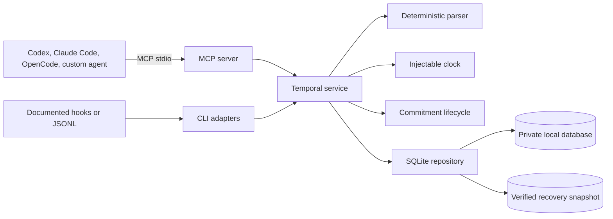

# TemporalThread

**Give AI agents a persistent sense of time.**

TemporalThread is a local-first MCP server and CLI that preserves temporal continuity across conversations, coding agents, projects, and restarts. It records when an interaction happened, distinguishes exact elapsed time from calendar-day difference, resolves relative phrases against their original message timestamp, and tracks explicit follow-up commitments.

It is more than a clock tool. If a user said “Let’s continue tomorrow” at 8:00 PM on July 15 in Bangkok, TemporalThread anchors “tomorrow” to July 16. When the user returns on July 19, it can report that four exact days elapsed and that the commitment is three calendar days overdue—without reinterpreting “tomorrow” using July 19.

## What it does

- Persists agent, project, session, interaction, temporal-reference, and commitment metadata in local SQLite.
- Exposes nine strictly validated tools over local MCP stdio.
- Handles timezone offsets, DST gaps and overlaps, midnight, leap days, vague expressions, out-of-order events, and idempotent retries.
- Enforces explicit commitment completion, cancellation, reopening, and rescheduling transitions.
- Defaults to storing only metadata plus matched temporal expressions—not full messages.
- Provides export, verified SQLite backup, purge, diagnostics, timeline, commitment, and generic ingestion commands.
- Verifies SQLite integrity, relationships, and immutable migration history during runtime startup.
- Supplies host configuration, skills, and best-effort capture adapters.

## What it does not do

- It does not call an LLM, host a cloud service, collect telemetry, or open a network port.
- MCP alone cannot intercept every platform’s conversation history.
- Automatic capture depends on events exposed by each host and can miss abnormal termination.
- A skill or hook improves reliability but cannot guarantee that an agent will always call a tool.
- It does not treat Ollama itself as an MCP host or modify every Ollama client.
- It does not fabricate exact times for vague phrases such as “later.”
- It does not automatically repair, replace, or downgrade a damaged or newer SQLite database.

## Architecture



The clock, parser, lifecycle, storage, service, transport, CLI, and integrations are explicit boundaries. See [Architecture](docs/ARCHITECTURE.md) and [Data model](docs/DATA-MODEL.md).

## Installation from source

The MVP is not yet published to npm. Clone this repository, install Node.js 24 and pnpm 11.9.0, then run from the repository root:

```sh
pnpm install --frozen-lockfile
pnpm build
cd apps/cli
npm link
temporalthread init
```

`npm link` exposes the built local `temporalthread` binary. Remove it later with `npm unlink --global temporalthread`. Initialization asks which integrations to prepare when attached to a terminal, detects the operating system and IANA timezone, creates the config/database, applies and verifies migrations, and prints every created or preserved path. It never edits host configuration silently.

For a non-interactive isolated setup:

```sh
temporalthread init --yes --timezone UTC --integration generic --json
temporalthread doctor
```

## Quick example

Start the MCP server from any compatible host:

```sh
temporalthread start
```

Or run the compiled basic client, which records an interaction and retrieves compact context:

```sh
node examples/basic-mcp-client/dist/index.js
```

The generic CLI accepts JSON, arrays, or JSONL:

```sh
temporalthread ingest --file integrations/generic/events.example.jsonl --json
temporalthread timeline
```

Create a private verified SQLite recovery snapshot:

```sh
temporalthread backup --output /private/path/temporalthread-backup.sqlite
```

## Host setup

### Codex

TemporalThread's Codex integration has three cooperating parts:

| Part | Responsibility |
| --- | --- |
| MCP server | Owns the temporal tools and all durable local data. |
| `temporal-awareness` skill | Teaches Codex when temporal context matters and when not to call a tool. |
| Lifecycle hooks | Best-effort recording for documented `SessionStart`, `UserPromptSubmit`, and `Stop` events. |

From the target project, preview and install the direct integration:

```sh
temporalthread integrate codex install --scope project --dry-run
temporalthread integrate codex install --scope project --yes
temporalthread integrate codex doctor --scope project
```

Use `--scope user` for all local projects. The installer validates the MCP process before changing Codex,
merges only TemporalThread-owned entries, creates timestamped backups, and never approves its own hooks.
Review the installed hook commands and accept Codex's trust prompt explicitly.

The repository also contains an official-format plugin under `integrations/codex/plugin` and a local
marketplace entry under `.agents/plugins/marketplace.json`. Plugin installation still requires the
`temporalthread` executable on `PATH`; the Codex IDE extension uses the direct installer because it does not
install plugins.

Hook capture is automatic only when a supported, trusted event is delivered. Compact context is injected
only for a resumed session, a temporal cue, a due commitment, or a meaningful timezone change. A new
`SessionStart` lifecycle row does not replace the prior meaningful user or assistant conversation used for
elapsed-time context. Creating a firm commitment, retrieving context outside those hook cases, and recording
an event missed by hooks still depend on Codex calling the MCP tools. A hook is not a transcript recorder and
abnormal termination can omit `Stop`.

For the July example, `record_interaction` anchors “tomorrow” to July 15 in `Asia/Bangkok`, and
`record_commitment` records the explicit follow-up. On July 19, `get_temporal_context` reports about four
days elapsed and a due date three calendar days in the past. Under the default
`temporal-references-only` mode, the complete prompt is not retained.

The Codex package, installer, schemas, hooks, and MCP behavior have automated coverage. Real Codex trust, UI,
skill discovery, and model behavior remain **not tested** after the owner deferred live-host certification.

Remove only managed Codex files while preserving the database:

```sh
temporalthread integrate codex uninstall --scope project --yes
```

See [Codex integration](docs/CODEX-INTEGRATION.md), [installation](docs/CODEX-INSTALLATION.md),
[privacy](docs/CODEX-PRIVACY.md), and [troubleshooting](docs/CODEX-TROUBLESHOOTING.md).

### Claude Code

Merge `integrations/claude-code/.mcp.json` and `hooks.json` into the target project, then copy the skill to `.claude/skills/temporalthread/SKILL.md`. Prompt and last-assistant-message fields are supported; transcript files are intentionally ignored. See [Claude Code setup](integrations/claude-code/README.md).

### OpenCode

Merge `integrations/opencode/opencode.json`, copy the typed plugin, and install the skill. MCP configuration is supported; automatic plugin capture is **experimental** pending live end-to-end host verification. See [OpenCode setup](integrations/opencode/README.md).

### Ollama

Build, choose an installed tool-capable model, and run:

```sh
OLLAMA_MODEL=qwen3 node examples/ollama-tool-client/dist/index.js "How long has it been?"
```

The example talks only to the configured local Ollama endpoint and TemporalThread stdio server. Its tool loop is tested with a mocked API; no specific model is certified. See [Ollama setup](integrations/ollama/README.md).

See [Integrations](docs/INTEGRATIONS.md) for the support matrix and generic fallback.

## Privacy modes

| Mode | Stored message data |
| --- | --- |
| `metadata-only` | identifiers, timestamps, timezone/offset, and hash |
| `temporal-references-only` | metadata plus matched phrases and resolutions; default |
| `full-local-history` | metadata, matched references, preview, and full text |

Full history is never enabled automatically. TemporalThread makes no outbound network request; connected MCP
hosts receive only explicitly requested, privacy-permitted results. Commitment rescheduling cannot create
stored original text when the existing commitment is privacy-redacted. See [Privacy](docs/PRIVACY.md).

## MCP tools

| Tool | Purpose |
| --- | --- |
| `get_current_time` | Current UTC and local wall-clock context |
| `record_interaction` | Idempotently persist an interaction under a privacy mode |
| `get_temporal_context` | Compact latest user/assistant interaction, elapsed time, references, and commitments |
| `get_last_interaction` | Most recent matching event; raw text requires explicit permission |
| `calculate_elapsed_time` | Exact duration plus local calendar-day difference |
| `resolve_relative_time` | Resolve a phrase against an explicit historical anchor |
| `record_commitment` | Store an explicit follow-up with resolved or fuzzy due range |
| `list_commitments` | List pending, due, overdue, completed, or cancelled items |
| `update_commitment` | Complete, cancel, reopen, or reschedule an item through lifecycle rules |

Every tool has strict input/output schemas and rejects unknown input fields. The host-neutral end-to-end
certification launches the real stdio server, exercises all nine tools, checks strict errors and privacy,
restarts the process, and verifies persisted continuity without relying on a specific agent host.

## Commitment lifecycle

- Repeated completion, cancellation, or reopening is idempotent.
- Completed and cancelled commitments must be reopened before crossing to the other terminal state.
- Rescheduling is an action that writes a new due resolution and returns the commitment to `pending`.
- Rescheduling clears prior terminal timestamps while retaining identity, project/session scope, and privacy.
- SQLite checks reject rows whose status contradicts completion or cancellation timestamps.

## CLI reference

```text
temporalthread init          initialize configuration, database, and examples
temporalthread start         run the MCP stdio server
temporalthread doctor        diagnose runtime, storage, and integration examples
temporalthread status        show private-content-free local status
temporalthread config        show/get/set configuration with backups
temporalthread timeline      list compact interaction metadata
temporalthread commitments   list commitments and derived status
temporalthread ingest        ingest JSON, an array, or JSONL
temporalthread export        export all privacy-permitted stored data
temporalthread backup        create and verify a private SQLite recovery snapshot
temporalthread purge         delete all domain data after confirmation
temporalthread integrate codex ...  install, inspect, diagnose, or remove the Codex integration
```

Use `temporalthread <command> --help` for options. `TEMPORALTHREAD_HOME`, `TEMPORALTHREAD_CONFIG_PATH`, `TEMPORALTHREAD_DATABASE_PATH`, timezone, locale, privacy, thresholds, text-size, and log-level environment overrides are available for isolated or advanced use.

`backup` is a complete SQLite point-in-time snapshot. `export` is privacy-permitted logical JSON; the current
MVP does not implement import. See [SQLite backup and recovery](docs/SQLITE-RECOVERY.md).

## Troubleshooting

- Run `temporalthread doctor --json` and `temporalthread status --json` first.
- If the command is missing after a source build, rerun `npm link` inside `apps/cli` and ensure the npm global binary directory is on `PATH`.
- If MCP does not appear, restart the host and review its project trust and MCP status.
- If hooks do not capture, inspect the host’s hook status and use `record_interaction` or `temporalthread ingest` as the supported fallback.
- Before upgrades or recovery work, create a verified snapshot with `temporalthread backup --output <new-path>`.
- If SQLite cannot open or health checks fail, stop all clients, preserve the database plus WAL/SHM files, and follow [SQLite backup and recovery](docs/SQLITE-RECOVERY.md).
- A host showing tools does not prove automatic capture; MCP and hook/plugin status are separate.

## Known limitations

- The deterministic English parser covers the documented MVP expressions, not unrestricted natural language.
- `next Friday` is defined as the next Friday strictly after the anchor date and reports that ambiguity policy.
- Fuzzy expressions remain fuzzy or unresolved.
- No import command exists yet; export is a logical portability format, while verified SQLite snapshots provide exact recovery.
- OpenCode automatic capture has type and adapter tests but no live host certification.
- Codex and Claude Code hook capture is best effort and requires local trust/configuration.
- The default stdio architecture is local-only; Streamable HTTP is a future opt-in design.

## Development

```sh
pnpm lint
pnpm typecheck
pnpm test
pnpm build
pnpm verify:host-neutral-mcp
pnpm verify:sqlite-recovery
pnpm verify:codex-package
pnpm verify:clean-source
pnpm audit --prod --audit-level high
```

Tests use a deterministic fake clock and cover DST, leap day, midnight, timezone change, privacy, sessions, checksummed migrations, malformed storage, commitment lifecycle transitions, all tools, real stdio process restarts, SQLite point-in-time recovery, CLI operations, installers, hooks, and the Ollama loop. CI runs the gates on Linux, macOS, and Windows.

For a non-publishing release dry run, start with an empty ignored `release-artifacts/` directory:

```sh
pnpm release:artifacts
pnpm release:sbom
pnpm verify:release-artifacts
```

These commands build eight tarballs, `SHA256SUMS`, a release manifest, and an SPDX 2.3 SBOM. They never
publish, tag, create a release, change repository visibility, or modify real Codex configuration. Current
functional packages remain prohibited for release while the documented dependency-security gate is blocked.

Read [Contributing](CONTRIBUTING.md), [Security policy](SECURITY.md), the [Roadmap](docs/ROADMAP.md), and the [Changelog](CHANGELOG.md). TemporalThread is available under the [MIT License](LICENSE).
