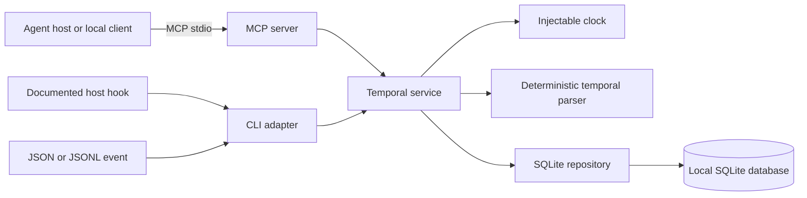

# Architecture

TemporalThread is a local-first TypeScript monorepo. The production entry point is a Model Context Protocol server over stdio; the CLI and host adapters use the same service and database boundaries.

## Boundaries

- `packages/shared-types` owns domain entities and strict Zod boundary schemas.
- `packages/config` owns OS-specific paths, configuration validation, environment overrides, backups, and permission-aware file creation.
- `packages/temporal-parser` resolves supported relative expressions against an explicit timestamp and IANA timezone. It does not call an LLM or the network.
- `packages/storage-sqlite` owns parameterized SQL, migrations, transactions, indexes, export, purge, integrity checks, and file permissions.
- `packages/core` coordinates sessions, privacy, parsing, elapsed time, commitment state, and compact context. Its `Clock` is injected.
- `apps/mcp-server` exposes nine schemas and delegates to the service. Transport is isolated so Streamable HTTP can be added later without changing domain behavior.
- `apps/cli` provides operations, generic ingestion, and documented host hook adapters.
- `integrations` and `skills` contain host-specific configuration and best-effort capture guidance.

## Write path

1. A public boundary validates the request and rejects unknown fields or oversized text.
2. The service canonicalizes the supplied instant to UTC while retaining its IANA timezone and offset.
3. Agent and project identities are upserted; an external session ID is preserved or a synthetic session is selected within the inactivity threshold.
4. The configured privacy mode decides whether text is parsed and whether raw text may be retained.
5. The parser resolves supported expressions using the interaction timestamp—not query time.
6. The interaction and temporal references are committed in one SQLite transaction. A unique idempotency key makes retries safe.

## Read path

Queries filter by stable internal identities after resolving agent, project, and session selectors. Last-interaction ordering uses occurrence time rather than insertion time. Temporal context is intentionally bounded: one last interaction, one previous session, five unresolved references, and a configurable maximum number of active commitments.

## Concurrency and recovery

SQLite foreign keys, WAL mode, a five-second busy timeout, and transactional writes support multiple local processes. Migrations are ordered, versioned, and each migration is atomic. See [SECURITY.md](SECURITY.md) for backup and recovery guidance; downgrades are not automatic.
