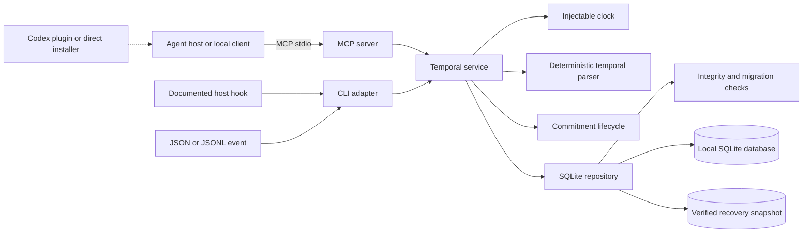

# Architecture

TemporalThread is a local-first TypeScript monorepo. The production entry point is a Model Context Protocol server over stdio; the CLI and host adapters use the same service and database boundaries.

## Boundaries

- `packages/shared-types` owns domain entities and strict Zod boundary schemas.
- `packages/config` owns OS-specific paths, configuration validation, environment overrides, backups, and permission-aware file creation.
- `packages/temporal-parser` resolves supported relative expressions against an explicit timestamp and IANA timezone. It does not call an LLM or the network.
- `packages/storage-sqlite` owns parameterized SQL, checksummed migrations, transactions, indexes, export, purge, health checks, verified online backups, and file permissions.
- `packages/core` coordinates sessions, privacy, parsing, elapsed time, explicit commitment transitions, and compact context. Its `Clock` is injected.
- `apps/mcp-server` exposes nine schemas and delegates to the service. Transport is isolated so Streamable HTTP can be added later without changing domain behavior.
- `apps/cli` provides operations, generic ingestion, verified database backup, documented host hook adapters, and the nested Codex integration management commands.
- `integrations/codex` owns Codex event schemas, MCP/hook configuration merging, safe paths, installation ownership/versioning, doctor probes, and official plugin packaging. It delegates all temporal work to the core service.
- `integrations` and `skills` otherwise contain host-specific configuration and best-effort capture guidance.

## Write path

1. A public boundary validates the request and rejects unknown fields, contradictory commitment fields, or oversized text.
2. The service canonicalizes the supplied instant to UTC while retaining its IANA timezone and offset.
3. Agent and project identities are upserted; an external session ID is preserved or a synthetic session is selected within the inactivity threshold.
4. The configured privacy mode decides whether text is parsed and whether raw text may be retained.
5. The parser resolves supported expressions using the interaction timestamp—not query time.
6. Commitment updates pass through a pure lifecycle transition before storage. Repeated terminal actions are idempotent, direct terminal-to-terminal changes are rejected, and rescheduling returns the row to pending.
7. Interactions and temporal references are committed in one SQLite transaction. A unique idempotency key makes retries safe.

## Read path

Queries filter by stable internal identities after resolving agent, project, and session selectors.
`get_last_interaction` retains the generic latest-event contract. Temporal context instead uses a dedicated
latest-conversational query restricted to user and assistant interactions, so lifecycle, tool, doctor,
installer, and health bookkeeping cannot replace the prior meaningful conversation. Both queries order by
occurrence time rather than insertion time. Temporal context is intentionally bounded: one conversational
interaction, one previous session, five unresolved references, and a configurable maximum number of active
commitments.

## Startup health boundary

Opening a runtime applies pending migrations and then requires all of the following:

- SQLite `integrity_check` returns `ok`;
- SQLite `quick_check` returns `ok`;
- `foreign_key_check` returns no violations;
- the migration table reaches the latest known version; and
- SQLite `user_version` matches that migration version.

Unknown future migration rows or `user_version` values, changed migration names, and checksum mismatches are refused. This prevents an older or altered build from silently opening an incompatible database.

## Concurrency and recovery

SQLite foreign keys, WAL mode, a five-second busy timeout, and transactional writes support multiple local processes. Migrations are ordered, checksummed, versioned, and atomic. `temporalthread backup --output <path>` uses SQLite’s online backup mechanism, verifies the temporary snapshot, publishes it through an exclusive no-overwrite operation, and verifies the published private destination again. See [SQLite recovery](SQLITE-RECOVERY.md) and [Security](SECURITY.md); downgrades and automatic repair are intentionally not performed.
