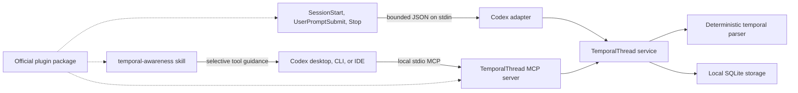

# Codex integration

TemporalThread gives Codex durable, local temporal continuity without changing the core service or adding a
remote endpoint. The existing stdio MCP server remains the only tool surface and the SQLite database remains
the source of truth.

The implementation follows the official capabilities recorded in the
[Codex capability report](CODEX-CAPABILITY-REPORT.md). It supports both an official-format plugin and a
direct user/project installer. Neither path has been published by this repository yet.

## Architecture

Codex-specific code stops at the adapter, installer, skill, configuration, and package boundaries. It does
not implement a second parser, database, commitment engine, or remote service.

## Component responsibilities

| Component | Does | Does not do |
| --- | --- | --- |
| MCP server | Validates and serves the nine TemporalThread tools over local stdio. | Intercept Codex events or open a network listener. |
| Core service | Stores interactions, resolves historical relative time, calculates elapsed/calendar time, and manages commitments. | Depend on Codex formats. |
| `temporal-awareness` skill | Guides Codex to retrieve/record only when time materially affects the task. | Store data or guarantee a tool call. |
| Lifecycle adapter | Handles three documented hook events, applies privacy, and returns bounded context when relevant. | Parse transcripts, create firm commitments, or block Codex. |
| Direct installer | Safely merges MCP/hooks/skill files, records ownership, diagnoses, upgrades, and removes managed entries. | Approve hook trust or overwrite uncertain ownership. |
| Plugin | Bundles the same skill, MCP map, and hooks in the official manifest structure. | Install the CLI, approve hooks, or support the IDE extension. |

## Verified surfaces

| Surface | MCP and skill | Plugin | Lifecycle automation | Status |
| --- | --- | --- | --- | --- |
| ChatGPT desktop Codex/Work | Supported | Supported | Best effort after trust | Supported configuration; automated package/integration tests |
| Codex CLI | Supported | Supported | Best effort after trust | Supported configuration; automated package/integration tests |
| Codex IDE extension | Supported through direct config | Unsupported | Host-dependent direct hooks | Partially supported; use the direct installer |
| ChatGPT web | No local stdio process | Plugin cannot use this local server | Unsupported | Unsupported |
| Mobile | Unsupported | Unsupported | Unsupported | Unsupported |

Automated tests simulate the documented contracts without changing a real Codex configuration. A user must
still review the generated files, trust the project where applicable, approve hook definitions, restart the
host, and confirm MCP visibility.

## Event flow

| Event | Input used | Automatic action | Context returned |
| --- | --- | --- | --- |
| `SessionStart` | `session_id`, `cwd`, `source` | Retrieve prior context, record non-conversational lifecycle timing | Only for a resumed session, due commitment, or timezone change |
| `UserPromptSubmit` | `session_id`, `turn_id`, `cwd`, `prompt` | Process under the configured privacy mode and record idempotently | Only for a temporal cue, resumed session, due commitment, or timezone change |
| `Stop` | `session_id`, `turn_id`, `cwd`, optional `last_assistant_message` | Record permitted assistant data and best-effort session activity/end state | Neutral JSON; never asks Codex to continue |

Hook input is limited to 256 KiB. Injected context is limited to 7,000 UTF-8 bytes and at most five active
commitments. It excludes transcripts, internal IDs, hashes, and database paths. Stored commitment titles are
treated as untrusted data, sanitized, and truncated before injection.

All hook failures return neutral output with a zero process exit. Malformed input, an unavailable database,
a parser failure, a five-second host timeout, or a missing MCP server must not prevent Codex from continuing.

`SessionStart` timing is operational bookkeeping, not a conversation turn. `get_temporal_context` selects the
latest user or assistant interaction, while the generic `get_last_interaction` tool can still return the
latest lifecycle/system row. Therefore a session start immediately followed by “I'm back” preserves the
elapsed time from the prior real conversation. A `Stop` event with `last_assistant_message` records an eligible
assistant interaction; a stop without assistant text records no synthetic interaction.

## Automatic versus model-driven behavior

Automatic when trusted hooks are delivered:

- session/prompt/stop timing is recorded idempotently;
- prompt or latest assistant text is processed according to the configured privacy mode;
- relative expressions may be retained as temporal references;
- compact prior context may be injected for a relevant prompt or session start;
- `Stop` can update a matching session's activity/end state on a best-effort basis.

Still model-driven through MCP:

- recording a firm commitment with `record_commitment`;
- retrieving context when no relevant hook injection occurred;
- recording an event missed because hooks were disabled, untrusted, timed out, or absent;
- completing, cancelling, reopening, or rescheduling a commitment;
- asking for privacy-permitted raw history explicitly.

TemporalThread does not deliver reminders and never marks a commitment complete without an explicit tool
call. A parsed phrase such as “tomorrow” is not itself proof of a commitment.

## July 15 to July 19 example

At `2026-07-15T20:00:00+07:00` in `Asia/Bangkok`, the user says “Let's continue tomorrow.” The default
privacy mode processes the prompt locally, stores the temporal reference and metadata, and discards the
complete prompt. “Tomorrow” resolves from the original July 15 anchor to July 16; a clear plan may then be
stored through `record_commitment`. Retrying the event uses the same idempotency identity and does not create
a duplicate interaction.

At `2026-07-19T23:00:00+07:00`, the user says “I'm back.” Compact context can report that about four days and
three hours passed, the expected continuation date was July 16, and July 19 is three local calendar days
later. A `SessionStart` event emitted seconds before this prompt cannot replace the July 15 conversation.
Codex may mention this naturally when it helps; the skill explicitly avoids repeatedly judging or reminding
the user about the gap.

## Failure and fallback behavior

1. If hooks are unavailable, the skill can use `record_interaction` and `get_temporal_context` through MCP.
2. If the plugin is unavailable, use `temporalthread integrate codex install` at user or project scope.
3. If MCP is unavailable, Codex continues the main task without fabricated temporal facts or repeated retry.
4. If existing TOML/JSON is malformed or an unmarked TemporalThread entry exists, installation stops without
   overwriting it and provides a repair path.
5. If uninstall cannot prove ownership of a modified skill or external MCP entry, it preserves the file.

## Observed local performance

An indicative development measurement on Apple silicon (`darwin/arm64`, Node 24.14.0), using a temporary
on-disk SQLite database, produced these medians:

| Operation | Median | Samples |
| --- | ---: | ---: |
| Record and parse an interaction | 0.411 ms | 250 |
| Retrieve compact temporal context | 0.829 ms | 250 |
| List 20 commitments | 0.421 ms | 250 |
| Start MCP and discover tools | 343 ms | 7 |
| Run the complete Codex doctor process | 701.4 ms | 7 |

These are local observations, not service-level guarantees. Hardware, filesystem, database size, process
startup, antivirus software, and host load can change the results. Lifecycle commands use a five-second
timeout and bounded work even when the optional integration fails.

## Limitations

- No guaranteed complete capture or durable session-end callback.
- No transcript scraping or parsing of `transcript_path`.
- No dedicated project-switch hook; each event's current working directory is normalized instead.
- No automatic reminder delivery or automatic commitment completion.
- No remote MCP endpoint, cloud sync, web dashboard, or external classification service.
- Plugin installation is unavailable in the IDE extension and on mobile.
- The deterministic English parser covers documented expressions, not unrestricted natural language.

See [installation](CODEX-INSTALLATION.md), [privacy](CODEX-PRIVACY.md), and
[troubleshooting](CODEX-TROUBLESHOOTING.md).
