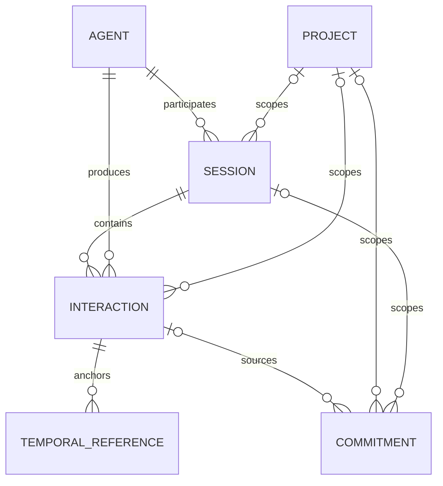

# Data model

All comparable timestamps are stored as ISO 8601 UTC instants. Interactions and commitments also preserve their original IANA timezone; interactions preserve the UTC offset observed at occurrence time. IDs are ULIDs and therefore sort by creation time.

| Entity | Purpose | Important identity and time fields |
| --- | --- | --- |
| Agent | One named agent implementation on a platform | unique `(name, platform)`, version, created/last-seen |
| Project | A normalized local workspace | unique normalized path, display name, optional remote |
| Session | Host-supplied or synthetic conversation grouping | agent, project, external ID, generated flag, start/last interaction |
| Interaction | Privacy-controlled event | idempotency key, occurrence instant, timezone/offset, hash, optional text |
| TemporalReference | Expression anchored to one interaction | original/normalized phrase, anchor, optional resolved range, confidence |
| Commitment | Explicit future follow-up | source, scope, due range, timezone, lifecycle status |

## Relationships

## Identity rules

- External session IDs are unique only within the same agent and project. A bare external ID that matches several scopes is rejected as ambiguous.
- When the host supplies no session ID, interactions from the same agent/project can share a generated session only when they occur within the configured inactivity threshold. Out-of-order events never extend a synthetic session into the future.
- Project identity uses its normalized absolute path, not its display name.
- The globally unique idempotency key is checked before related metadata is created and again inside the insert transaction.

## Privacy fields

Every interaction stores a SHA-256 message hash when text is supplied. `text_preview` and `raw_text` are null unless that individual interaction uses `full-local-history`. Temporal references are absent in `metadata-only`; the default `temporal-references-only` retains only matched phrases and resolutions. Commitment `original_text` follows the source interaction’s privacy permission. Rescheduling never creates commitment original text when the existing row has none.

## Conversation context

Interaction roles remain `user`, `assistant`, `system`, and `tool`. The generic latest-interaction query may
return any role. Temporal context has a narrower contract: its previous meaningful conversation is the newest
`user` or `assistant` interaction by occurrence time. Internal lifecycle rows such as Codex `SessionStart`
remain stored and queryable but cannot reset elapsed conversation time. A real assistant response recorded
from `Stop.last_assistant_message` remains eligible; a `Stop` event without assistant text creates no
interaction.

This is a query rule, not a schema change. Existing databases and rows require no migration. If a future
integration supports meaningful system conversation, it must add an explicit classification rather than
relying on lifecycle message content.

## Commitment status

Persisted status is `pending`, `completed`, or `cancelled`. `due` and `overdue` are query-time display states derived from a pending commitment’s due range and current clock. `rescheduled` is an update action, not a persisted terminal state: it writes the new due resolution, clears completion/cancellation timestamps, and returns the commitment to `pending` while retaining its identity and scope.

Lifecycle invariants are enforced in both the service and SQLite schema:

- `pending` has no completion or cancellation timestamp;
- `completed` has `completed_at` and no `cancelled_at`;
- `cancelled` has `cancelled_at` and no `completed_at`;
- repeated completion, cancellation, or reopening is idempotent;
- crossing directly between completed and cancelled is rejected until the commitment is reopened; and
- rescheduling from any valid state reopens the commitment and preserves privacy restrictions.

## Migrations

`schema_migrations` records each version, name, application time, and SHA-256 checksum. Migration definitions are strictly ordered and immutable after application. Startup refuses unknown future versions, changed names, and checksum mismatches rather than silently downgrading or accepting an altered history.

- Version 1 creates the domain schema.
- Version 2 adds temporal query indexes.
- Version 3 rebuilds commitments with lifecycle consistency checks, converts the legacy persisted `rescheduled` status to `pending`, and repairs missing terminal timestamps on legacy completed/cancelled rows.

Each migration executes transactionally. SQLite `user_version` is synchronized with the latest migration. The application does not implement down migrations because an automated downgrade could discard newer data; restore a verified backup with its matching application version instead.
