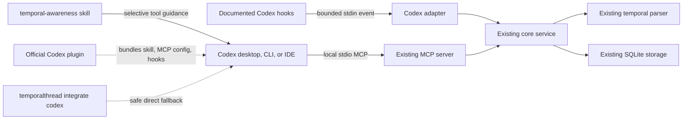

# Phase 2 Implementation Plan

Status: approved implementation design based on the 2026-07-20 capability audit.

## Success criteria

Phase 2 succeeds when the existing core remains the source of truth and a user can safely install, inspect,
upgrade, diagnose, dry-run, and remove the Codex integration at user or project scope. The official plugin,
direct installer, skill, MCP server, and supported hooks must describe the same privacy and capability model.
All tests use temporary paths and deterministic clocks, the packed artifact is exercised, and every quality
gate passes without touching a real Codex configuration.

## Verified capability summary

- Local stdio MCP, user/project config, skills, and the three selected lifecycle hooks are officially
  supported.
- Official plugins can bundle skills, MCP server configuration, and hooks through
  `.codex-plugin/plugin.json`.
- Plugins work in ChatGPT Work mode, desktop Codex, and Codex CLI, but not in the IDE extension.
- Direct MCP configuration and skills work in the IDE extension and remain the fallback.
- `SessionStart`, `UserPromptSubmit`, and `Stop` expose enough documented data for best-effort timing,
  bounded context injection, and privacy-filtered prompt/assistant handling.
- Codex does not provide a guaranteed durable session-end event or stable transcript format.

See [CODEX-CAPABILITY-REPORT.md](CODEX-CAPABILITY-REPORT.md) for sources and limitations.

## Selected integration design



The official plugin is the primary distributable Codex package. The nested CLI installer is a first-class
direct/manual path for user and repository scope, for the IDE extension, and for users who do not use a
plugin marketplace. Both paths use the same versioned templates and adapter.

No connector, remote MCP endpoint, web service, separate hook database, or second temporal parser will be
added.

## Planned files

### Add

- `integrations/codex/package.json`: versioned integration artifact metadata and packing files.
- `integrations/codex/src/adapter.ts`: strict, bounded Codex event normalization and fail-open dispatch.
- `integrations/codex/src/config.ts`: official MCP/hook/skill template construction.
- `integrations/codex/src/installer.ts`: scoped install, upgrade, backup, atomic commit, and rollback.
- `integrations/codex/src/uninstaller.ts`: ownership-aware component removal and optional explicit purge.
- `integrations/codex/src/doctor.ts`: structured PASS/WARN/FAIL checks.
- `integrations/codex/src/manifest.ts`: installation manifest schema and semver comparison.
- `integrations/codex/src/paths.ts`: cross-platform user/project path resolution and safe containment.
- `integrations/codex/src/output.ts`: human and JSON result contracts with safe fields.
- `integrations/codex/templates/mcp/*`: installed-package and development MCP templates.
- `integrations/codex/templates/hooks/hooks.json`: short-timeout supported hooks.
- `integrations/codex/plugin/.codex-plugin/plugin.json`: official plugin manifest.
- `integrations/codex/plugin/.mcp.json`: bundled installed-CLI MCP server map.
- `integrations/codex/plugin/hooks/hooks.json`: optional plugin hooks.
- `integrations/codex/plugin/skills/temporal-awareness/SKILL.md`: packaged skill copy.
- `integrations/codex/plugin/README.md`, license/privacy/compatibility files as required for the artifact.
- `.agents/plugins/marketplace.json`: repository marketplace entry for local validation.
- `skills/codex/temporal-awareness/SKILL.md`: canonical official skill source.
- focused unit, integration, end-to-end, and packed-install tests under `tests`.
- `docs/CODEX-INTEGRATION.md`, `docs/CODEX-INSTALLATION.md`, `docs/CODEX-PRIVACY.md`,
  `docs/CODEX-TROUBLESHOOTING.md`, and `docs/PHASE-2-FINAL-REPORT.md`.

The exact source split may be kept smaller where modules remain cohesive. Release code will not retain
placeholder wrapper files solely to mirror a target tree.

### Modify

- `pnpm-workspace.yaml` to include the integration package.
- root `package.json` for package validation scripts only when needed.
- `apps/cli/src/program.ts` and new CLI command modules for `integrate codex`.
- `apps/cli/src/hook-adapter.ts` or its replacement so existing host behavior delegates through a clean
  Codex boundary without moving Codex rules into core.
- minimal service/repository code only if a tested session activity/end operation is needed.
- `biome.json` and `.gitignore` to exclude generated Graphify/RepoMem output.
- `README.md`, `docs/INTEGRATIONS.md`, `CHANGELOG.md`, architecture/privacy/security documents where public
  behavior changes.
- the existing workflow only as explicitly required for cross-platform packaging validation, without adding
  unrelated automation.

The Phase 1 `integrations/codex/*.mjs` scripts and old `skills/codex/temporalthread` path will be migrated or
retired only after compatibility tests cover their replacement.

## CLI design

Add one nested command group to the existing executable:

```text
temporalthread integrate codex install
temporalthread integrate codex uninstall
temporalthread integrate codex status
temporalthread integrate codex doctor
temporalthread integrate codex print-config
temporalthread integrate codex install-skill
temporalthread integrate codex remove-skill
```

Shared options will include `--scope user|project|manual`, `--privacy`, `--yes`, `--dry-run`, `--json`,
`--no-hooks`, `--skill-only`, and `--mcp-only` where meaningful. Non-interactive operation must be explicit
and deterministic. Interactive prompts will use Commander conventions and will not be required by tests.

The installer will validate prerequisites before mutation, show scope and privacy, back up every existing
managed target, write through same-directory temporary files, validate the resulting files, roll back the
current transaction on failure, write a content-free ownership manifest, and run doctor after a successful
commit. Malformed TOML is a safe refusal, not an overwrite.

Uninstall will remove only an owned MCP table, owned hook groups, owned skill files, and the installation
manifest. User-modified managed files are preserved with a warning unless ownership is unambiguous. The
database is always kept unless an explicit separate purge option is supplied.

## Installation manifest and upgrades

The manifest will contain:

- TemporalThread and integration versions;
- schema version and installation timestamp;
- scope and selected components;
- managed paths and created backup paths;
- privacy mode at installation;
- detected/supported surfaces;
- checksums of managed integration files where needed for ownership decisions.

It will never contain prompt, response, temporal phrase, database row, secret, environment value, or raw
database contents. Upgrade compares semantic versions, preserves config/database, backs up replacements,
and refuses a silent downgrade. Reinstalling the same version is idempotent.

## Adapter and lifecycle behavior

The Codex adapter will accept only JSON objects below a strict byte limit. It will validate documented
fields, normalize missing project/session identity through existing strategies, preserve supplied timestamps
where valid, fall back to configured IANA timezone, and create deterministic idempotency keys from the
integration, event, session, turn, safe event time, and normalized project identity.

Implemented events:

1. `SessionStart`: retrieve bounded context, record timing, and return meaningful context without IDs.
2. `UserPromptSubmit`: process prompt text in memory, apply the selected privacy mode, record idempotently,
   and inject prior context only for temporal/resumption/due-commitment relevance.
3. `Stop`: optionally record privacy-permitted assistant data, update session activity/end state when safely
   represented, and always return neutral JSON.

Unknown, incomplete, oversized, malformed, locked-database, unavailable-service, parser, and timezone
failures return a neutral successful hook result. The hook entry point will use stdin only, have no command
interpolation, set an explicit short host timeout, avoid retries beyond the configured SQLite busy timeout,
and never output prompt text in diagnostics.

No automatic deterministic classifier will create firm commitments from ambiguous natural language.
Automatic parsing may store privacy-permitted temporal references. The skill will call `record_commitment`
for clear commitments, while code examples, quotations, negations, logs, fixtures, and hypotheticals remain
non-commitments.

## Skill behavior

`temporal-awareness` will:

- enumerate meaningful retrieval cues and explicit non-relevant cases;
- treat stored timestamps/timezones as truth and anchor old relative phrases to their original event;
- distinguish exact duration from local calendar-day difference;
- use only the nine real MCP tools;
- record clear commitments without inventing exact dates for vague phrases;
- avoid silent completion/cancellation and avoid claiming reminder delivery;
- keep context natural, selective, and free of internal IDs;
- state privacy expectations for all three modes;
- fail open without repeated retries or fabricated time context.

A test will parse frontmatter, validate the name/description, compare mentioned tools to the server registry,
and assert required relevance, failure, privacy, and identifier-safety guidance.

## MCP configuration

Released mode uses `temporalthread start`. Development mode uses a user-selected built JavaScript entry
with `node`; no personal path is committed. Both set the server optional, retain write approvals, and use
official timeout keys. TOML parsing/serialization must preserve unrelated tables and values, including
unrelated MCP servers.

The MCP startup check will spawn without a shell, perform an MCP initialization/tool-list handshake, impose
a short timeout, and terminate only the child it created. Tests use the built workspace or packed artifact,
never a live user's installed executable.

## Migration requirements

No database migration is planned at audit time. Existing interaction idempotency and session selection are
reused. If session closure cannot be represented safely through the current repository API, add the smallest
backward-compatible repository/service method; add a database migration only if a new persisted field is
strictly necessary. Any such change must be deterministic, transactional, and documented before merge.

The integration installation manifest has its own versioned JSON schema and is not stored in the temporal
SQLite database.

## Security risks and controls

| Risk | Control |
| --- | --- |
| Malformed or adversarial hook input | Byte limit, JSON-object schema, no evaluation, no shell, neutral failure. |
| Prompt disclosure | In-memory processing, privacy filtering, sanitized errors/logs, no argv or temp-file prompt. |
| Config loss | Parse first, timestamped backup, atomic same-directory replace, validate, rollback. |
| Path traversal/symlink overwrite | Resolve scope roots, containment checks, `lstat`, refuse unsafe ownership. |
| Hook blocks Codex | Exit zero, neutral output, explicit short timeout, `required = false` MCP. |
| Plugin self-trust | Never attempt it; require visible Codex trust review. |
| Arbitrary process execution | Fixed executable/argument arrays and validated development entry path. |
| Duplicate events | Safe metadata idempotency keys plus existing unique database constraint. |
| Prompt injection from stored content | Bounded structured summaries; stored text is quoted data, not instructions. |
| Cross-platform path errors | Node path APIs, no Bash requirement, fixtures for spaces/Unicode/Windows paths. |

## Privacy risks and controls

- The installer defaults to and preserves `temporal-references-only`; it does not silently change the user's
  existing mode.
- `metadata-only` does not retain prompt text or temporal phrase text.
- `temporal-references-only` processes text locally and stores matched references/commitments, not complete
  prompts.
- `full-local-history` requires explicit opt-in and remains local.
- Safe logs contain timestamp, component, event type, status, duration, and error code only.
- Status, doctor, hook context, and manifests exclude stored text, hashes, stable internal IDs, secrets, and
  avoidable full local paths.
- No telemetry, analytics, cloud sync, remote MCP, or external LLM classification will be added.

## Testing strategy

Follow test-driven increments with `FakeClock` and temporary home/repository/database directories:

1. Foundation and skill validation unit tests.
2. Adapter tests for every selected event, malformed/oversized/missing inputs, privacy modes, idempotency,
   false-commitment examples, database failures, and safe output/logging.
3. Installer/uninstaller tests for user/project/manual scope, parsed merge, unrelated config, backups,
   rollback, read-only paths, existing/newer versions, partial installs, ownership refusal, component flags,
   spaces, Unicode, and platform path fixtures.
4. Doctor tests for runtime, command, MCP handshake/tools, database/schema/timezone/privacy, config, skill,
   hooks, paths, versions, output modes, and exit severity.
5. End-to-end July 15 to July 19 flow with server restart and privacy assertions.
6. Pack the integration/CLI artifact, install it in an isolated temporary prefix/home, start it over stdio,
   install/uninstall Codex integration, and verify the database survives.
7. Run formatting, lint, typecheck, all tests, build, package-content checks, and dependency audit.

No test may read or modify the real `~/.codex`, `~/.agents`, TemporalThread database, or plugin cache.

## Rollback strategy

Each installation transaction calculates a plan before writes. Existing files receive unique timestamped
backups. New content is written to restrictive same-directory temporary files, validated, then renamed. If
any later step fails, files changed in that transaction are restored from their backups and newly created
files are removed. Interrupted remnants are recognized as stale and reported by doctor.

Uninstall does not restore a whole old config over newer user changes. It removes only the parsed owned MCP
entry and exact managed hooks/skill content, preserving everything else. Backups remain user-owned until an
explicit cleanup command is designed.

## Release strategy

- Keep work on the current feature branch with small reviewed commits.
- Version the integration with the repository for Phase 2 and include the integration package in workspace
  packing checks.
- Build an official plugin artifact and a direct CLI installation path from the same canonical templates.
- Verify package contents and packed installation on temporary macOS/Linux/Windows paths in tests/CI.
- Update public docs and `CHANGELOG.md` with actual support levels.
- Do not publish packages, submit the plugin, create a GitHub release, or tag a release in Phase 2.

## Unsupported behavior

- Complete or guaranteed conversation capture.
- Guaranteed session-end delivery.
- Transcript scraping or parsing.
- Plugin installation/use in the IDE extension or mobile.
- Local stdio MCP in ChatGPT web.
- Automatic reminder delivery.
- Automatic commitment completion.
- Remote service, synchronization, dashboard, or other-agent implementation.
- Exact due timestamps invented for vague language.

## Implementation phases

1. **Foundation:** commit the audit documents, exclude generated machine output, and add the integration
   workspace skeleton.
2. **Boundary:** build schemas, safe paths, manifest/version contracts, structured results, and fail-open
   Codex adapter with tests.
3. **Skill and plugin:** author/validate `temporal-awareness`, official plugin manifest, `.mcp.json`, hooks,
   and repo marketplace.
4. **Configuration and lifecycle:** parsed TOML merge/removal, bounded hooks, compact context, and MCP startup
   validation.
5. **CLI experience:** install, uninstall, status, doctor, print-config, skill operations, dry-run, JSON,
   rollback, and upgrades.
6. **Documentation and compatibility:** public guides, privacy/security/troubleshooting, README, integrations
   matrix, changelog, and actual automatic/manual behavior.
7. **End-to-end and package validation:** July workflow, isolated packed install/uninstall, cross-platform
   fixtures/CI, audit, final repository search, and `PHASE-2-FINAL-REPORT.md`.
